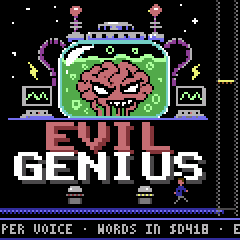
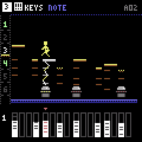
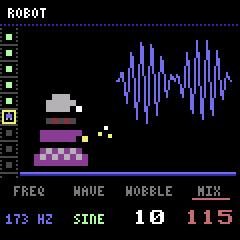
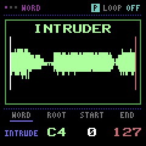

# EVILGENIUS

EVILGENIUS is a SID Chip Groovebox for the MVave FM-1. 6 tracks, SID Chips, Speech Synthesis, Advanced Sequencing. Full P-Lock sound locks.

It is a firmware for the M-VAVE FM-1: FIZZ's sequencer and controls, a C64 SID for every voice, the SAM speech
synthesizer for the words, and the screen of a C64 game about the Evil Genius's tower (an agent, robots, lifts, searched
cabinets). The art and the spoken lines are original.

- **[Try it in the browser](https://quixotic7.github.io/evilgenius/try/)**: the code the FM-1 runs, on a drawn FM-1.
- **[Install it](https://quixotic7.github.io/evilgenius/install/)** on an FM-1 over USB, from Chrome or Edge. Back up
  what your current firmware keeps first; M-VAVE's firmware can be put back from the same page.
- **[Manager](https://quixotic7.github.io/evilgenius/manager/)**: back up and restore the unit's projects, import and
  export presets.
- **[PLAYING.md](PLAYING.md)**: how to play it, organised by "how do I ...". **[CHANGELOG.md](CHANGELOG.md)**: what
  each release changed.

   

## What it does

- **Six tracks of SID**: three oscillators a voice with pulse width, ring modulation and sync, three envelopes, an
  LFO, the chip's filter and its routing; eight voices across the FM-1's two cores.
- **Speech**: VOX sounds speak words SAM renders on the unit, played through the SID's volume register and, if you
  like, its filter. 54 words, or type your own.
- **Step locks**: any step can hold its own sound, word, level, pan and effect sends; chance, conditions, ratchets,
  micro-timing, slides and functions per step; MIDI effects per track.
- **Eight effects** as floors of a tower: CHORUS, ECHO, ROOM, CRUSH, ROBOT, WARP, GLITCH, TV, with a send per track
  into each.
- **95 factory sounds**: basses, leads, keys, pads, drums, effects and speech, and **PAL arpeggios**: an LFO wave
  that plays a chord's notes one a frame on a single voice, as C64 music does.
- **USB and Bluetooth MIDI, USB audio** to the computer, **USB host** for a USB-MIDI keyboard or synth; four projects
  and 128 presets of your own on the unit.

## Build and test

The core is plain C99 with no OS calls (simulated time, deterministic). Its tests and the screen renders need only a
C compiler:

```sh
make -C tools build/test_app && tools/build/test_app   # the app's checks
make -C tools tour && tools/tour tools/eg/tour.txt OUT  # every screen as a PNG in OUT/
```

The FM-1 package, the browser build and the releases are in [BUILDING.md](BUILDING.md):

```sh
git submodule update --init --recursive
python3 firmware/build.py          # firmware/app/build/evilgenius-ble.fwsc (the one package: USB + Bluetooth)
python3 firmware/build.py --web    # the browser emulator; tools/eg/make_try.py puts it in site/try/
```

The site (`site/`) is static: the landing page, `try/`, `install/` and `manager/`, published by
`.github/workflows/pages.yml`.

## License

MPL-2.0 (see [LICENSE](LICENSE) and [LICENSING.md](LICENSING.md)).

## Credits

- Built on [FIZZ](https://github.com/Quixotic7/FIZZ) (the sequencer, the controls, the effects' chorus, delay and
  reverb), [fm1-base](https://github.com/charlesvestal/fm1-base) and felucca-bsp (the FM-1 port and the installer; the
  update protocol and loader are Felucca's, Leo Kuroshita, Hügelton Instruments).
- The SID model is from [fm1-sid](https://github.com/joakimeriksson/fm1-sid) (Joakim Eriksson, BSD-2-Clause).
- The speech is [SAM](https://github.com/s-macke/SAM), the Software Automatic Mouth (see LICENSING.md for its status).
- Drawn with [plutovg](https://github.com/sammycage/plutovg) (MIT) under the pixel kit.
- The sequencer's controls owe a lot to the OMX-27 Form sequencer and to Elektron's machines; the look is a tribute
  to the C64 and its games. Not affiliated with M-VAVE, Commodore or any game's publisher.
